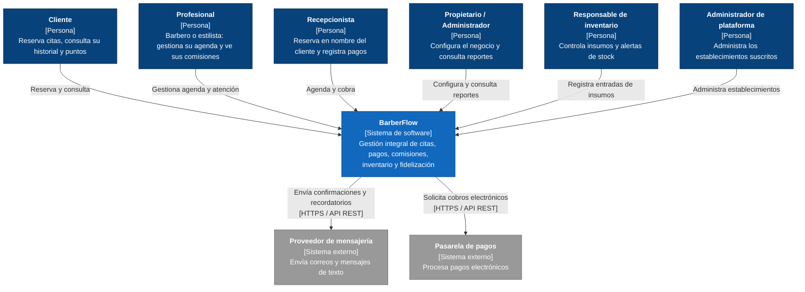
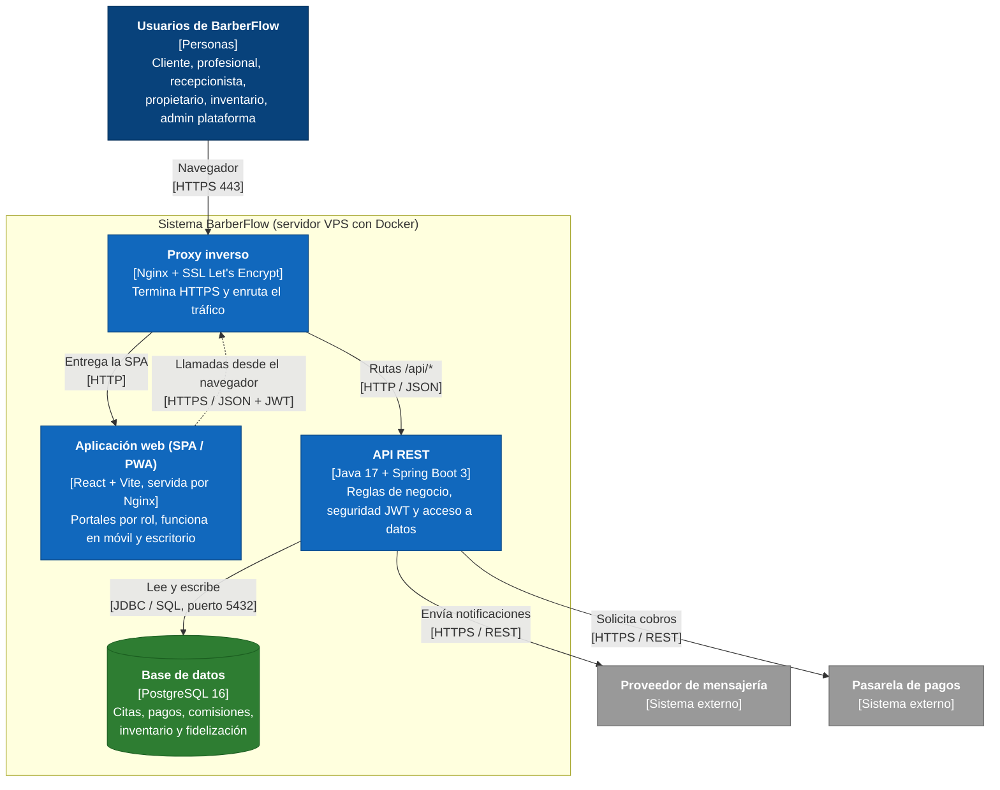
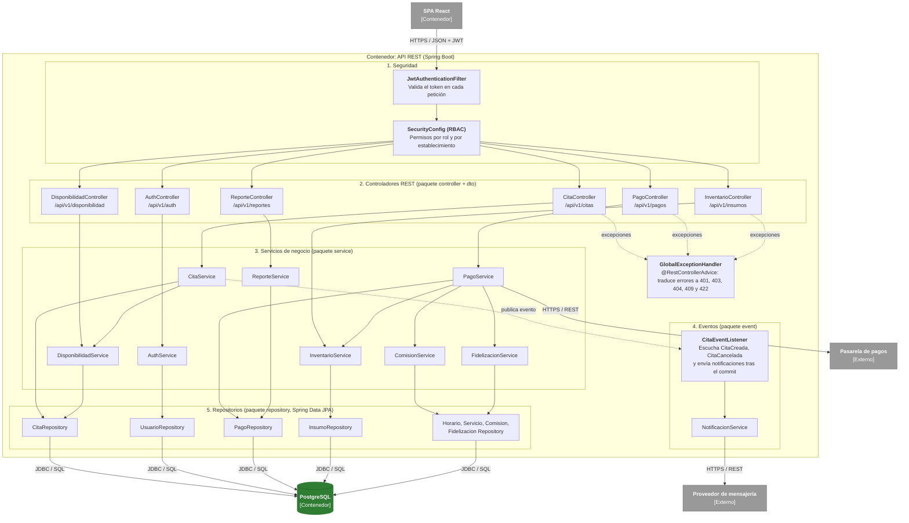
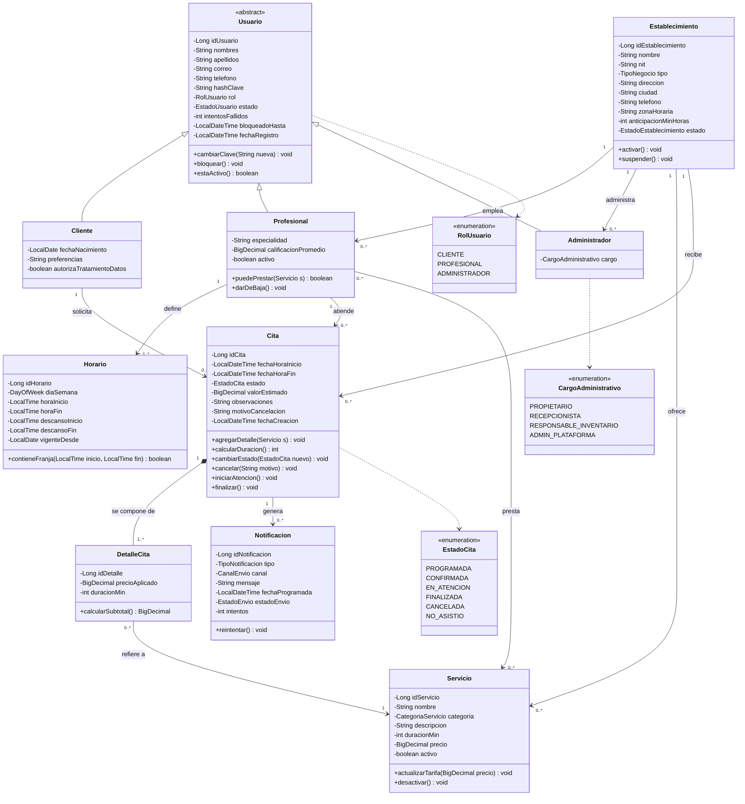
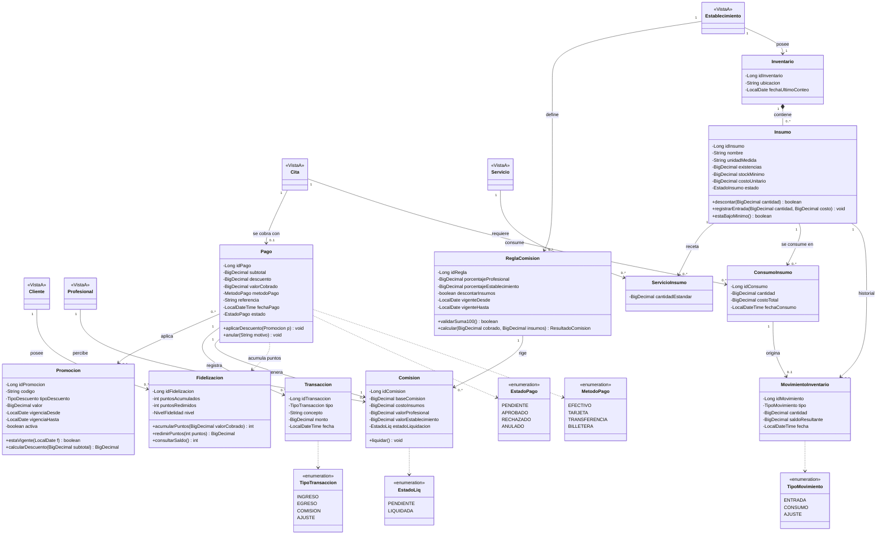
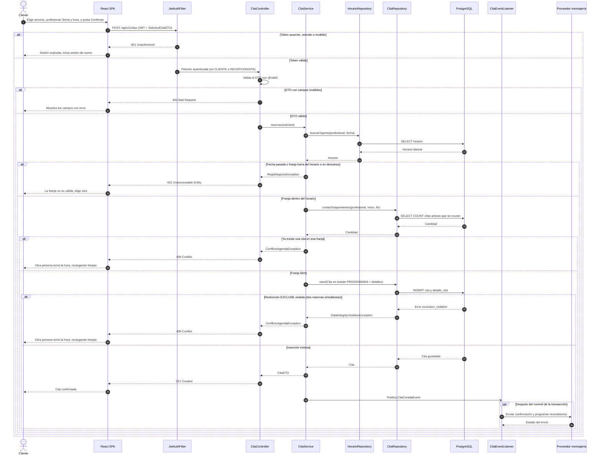
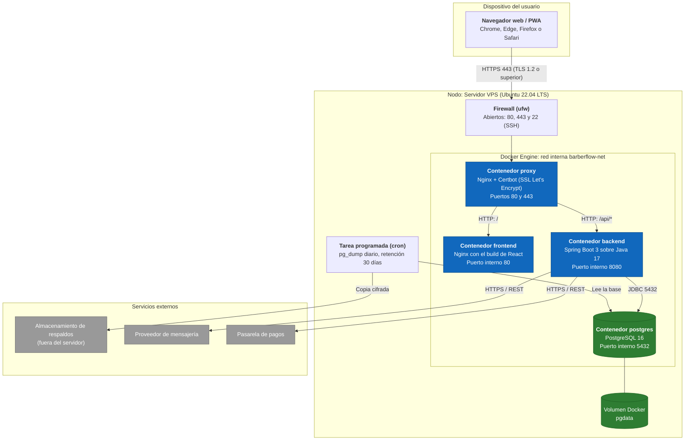

# BarberFlow · Hito 2: Arquitectura, C4 y UML

Equipo: Cristian Johan Guerrero Mejia · Anderson Steven Guerrero Mejia

Los diagramas están escritos como código (Mermaid) en la carpeta `diagramas/`. Se visualizan directamente en GitHub o pegando el contenido de cada `.mmd` en https://mermaid.live para exportar PNG/SVG.

---

## 1. Estilo arquitectónico: Monolito Modular (con capas internas)

**Decisión.** BarberFlow se construye como **un único backend Spring Boot desplegable**, dividido en **módulos de negocio** (autenticación, citas, disponibilidad, pagos, comisiones, inventario, fidelización, reportes, notificaciones). Dentro de cada módulo se mantiene la separación en capas `controller → service → repository → domain`, con DTOs y un manejo centralizado de errores.

**Por qué responde a los RNF críticos:**

| RNF | Cómo lo resuelve el estilo |
|-----|----------------------------|
| **RNF-03 Rendimiento** (2 s con 200 usuarios concurrentes) | Las llamadas entre módulos son en memoria, sin latencia de red. Una consulta de disponibilidad es una sola consulta a PostgreSQL con índices. |
| **Concurrencia** (RF-07, RNF-07) | Una sola base de datos transaccional permite usar `@Transactional` y la restricción `EXCLUDE` de PostgreSQL para impedir citas superpuestas. Con microservicios esto exigiría transacciones distribuidas. |
| **RNF-01 Seguridad** | Un único punto de entrada (filtro JWT + RBAC) protege todos los módulos. El proxy Nginx termina HTTPS. |
| **RNF-07 Integridad** | Pago, comisión, transacción, inventario y puntos se ejecutan en **una misma transacción atómica**, algo natural en un monolito. |
| **RNF-04 Escalabilidad** | El backend es *stateless* (JWT sin sesión en servidor), por lo que se pueden levantar varias réplicas detrás del proxy. Si un módulo crece, se puede extraer después porque ya está aislado. |
| **Mantenibilidad** | Equipo de 2 personas: un solo repositorio, un solo despliegue y fronteras claras entre módulos, sin la complejidad operativa de microservicios. |

**Alternativas descartadas:** *Microservicios* (complejidad operativa y transacciones distribuidas innecesarias para 2 desarrolladores y 200 usuarios concurrentes) y *Arquitectura Hexagonal pura* (más ceremonia de puertos y adaptadores de la que el equipo puede sostener en este semestre). Esta decisión se formaliza en el ADR-001.

> Nota de coherencia: el informe del Parcial 1 describe "tres capas". Este hito lo refina: se mantiene la separación por capas, pero organizada por módulos de negocio (monolito modular).

---

## 2. Modelo C4

### Nivel 1 · Diagrama de Contexto
Muestra BarberFlow como una caja única, los 6 roles de usuario y los 2 sistemas externos.

### Nivel 2 · Diagrama de Contenedores
Unidades desplegables: proxy, SPA/PWA, API REST y base de datos, con tecnologías y protocolos.

### Nivel 3 · Diagrama de Componentes (Backend)
Organización interna de la API: seguridad, controladores, servicios, repositorios, eventos y manejo de errores.

---

## 3. Modelado UML

### 3.1 Diagrama de Clases de Dominio
Es un único modelo dividido en dos vistas para que sea legible. Las clases marcadas `<<Vista A>>` en la vista B están definidas en la vista A.

**Vista A: usuarios, reservas y agenda**

**Vista B: pagos, comisiones, fidelización e inventario**

**Cardinalidades destacadas:** 1:1 (Establecimiento–Inventario) · 1:N (Cita–DetalleCita, Establecimiento–Servicio) · N:M (Servicio–Insumo mediante `ServicioInsumo`; Profesional–Servicio).

### 3.2 Diagrama de Secuencia Full Stack: Reservar una cita (RF-06 y RF-07)
Flujo transaccional más crítico (necesidad NEC-04, prioridad Crítica). Incluye los errores **401, 400, 422 y 409**, y el evento posterior de notificación.

### 3.3 Diagrama de Despliegue

---

## 4. Persistencia: Diccionario de Datos y mapeo JPA

| Entregable | Ubicación |
|---|---|
| Diccionario de Datos (22 tablas, 157 columnas, índices y anotaciones ORM) | [`diccionario-datos.md`](diccionario-datos.md) |
| Esquema SQL (Flyway) con la restricción anti-solapamiento de citas | [`backend/src/main/resources/db/migration/V1__esquema_inicial.sql`](../../backend/src/main/resources/db/migration/V1__esquema_inicial.sql) |
| Entidades `@Entity` (21) y enums | `backend/src/main/java/com/barberflow/domain/` |
| Interfaces `JpaRepository` (20) | `backend/src/main/java/com/barberflow/repository/` |

Buenas prácticas aplicadas: `FetchType.LAZY` en todas las relaciones, `@Enumerated(EnumType.STRING)`, índices declarados en `@Table(indexes = ...)`, dinero con `BigDecimal` / `NUMERIC(12,2)`, herencia `JOINED` para usuarios, composición `Cita` ◆ `DetalleCita` y `@EntityGraph` para evitar el problema N+1.
